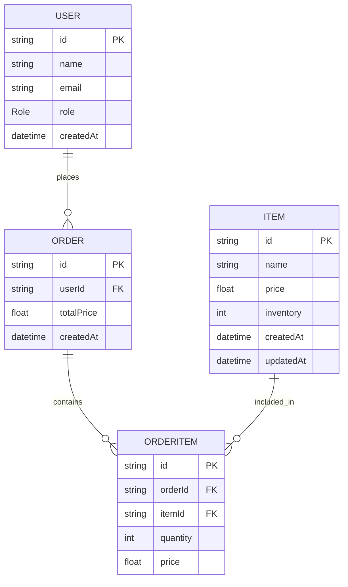

# Grocery Booking System API
Node.js (TypeScript) REST API for a grocery booking system with inventory management, transactional order processing, and fully Dockerized deployment.

## Tech Stack
- Node.js + Express
- TypeScript
- PostgreSQL
- Prisma ORM
- Docker

## Setup Instructions (Docker)
1. **Clone the repository**
   ```bash
   git clone https://github.com/sumuongit/grocery-booking-system.git
   cd grocery-booking-system
   ```

2. **Environment Setup**      
   ```bash
   cp .env.example .env
   ```
   - For Docker, ensure:  `DATABASE_URL=postgresql://postgres:postgres@db:5432/grocery`

3. **Run the Application (App + DB)**
   ```bash
   docker-compose up --build -d
   ```
   - API will be available at: http://localhost:5000 (base URL: /api)

4. **Run Database Migrations**
   ```bash
   docker-compose exec app npx prisma migrate deploy
   ```

5. **Seed the Database**
   ```bash
   docker-compose exec app npx prisma db seed
   ```

## Run Locally (Optional)
1. **Install dependencies**
   ```bash
   npm install
   ```

2. **Environment Setup**      
   ```bash
   cp .env.example .env
   ```
   - Update `DATABASE_URL` if needed

3. **Start the Database**
   ```bash
   docker-compose up -d db
   ```

4. **Initialize Database & Seed Data**
   ```bash
   npx prisma migrate dev
   npx prisma db seed
   ```

5. **Run the Application**
   ```bash
   npm run dev
   ```

## Running Tests
```bash
npm test
```
- Tests are executed locally using Jest. Ensure the database is running (via Docker or locally).

### API Testing
**Import the Postman collection located at:**
`/docs/postman_collection.json`

**Variables**
- **base_url:** http://localhost:5000/api
- **id:** Replace with actual item ID

## Database Schema (ER Diagram)


## API Endpoints

### Public
Both Admin and User roles use the same endpoint to view available grocery items.
- **Get Items:** GET /api/items

### Admin
Header: x-role: ADMIN

- **Create Item:** POST /api/admin/items
- **Update Item:** PATCH /api/admin/items/{id}
- **Delete Item:** DELETE /api/admin/items/{id}
- **Update Inventory:** PATCH /api/admin/items/{id}/inventory

### User
Header: x-role: USER

- **Place Order:** POST /api/user/orders

**Mock User:**
- A mock user is used to simulate authenticated requests
- All order operations are performed using a predefined user ID: 11111111-1111-1111-1111-111111111111

## Sample Request
POST /api/admin/items

```json
{   
   "name": "Soap",
   "price": 70.00,
   "inventory": 150
}
```
POST /api/user/orders

```json
{
  "items": [
    { "itemId": "550e8400-e29b-41d4-a716-446655440000", "quantity": 2 },
    { "itemId": "550e8400-e29b-41d4-a716-446655440001", "quantity": 3 }    
  ]
}
```

## Notes
- Role-based authorization via request header
- Centralized error handling middleware
- Logging implemented using Winston
- Input validation handled at controller level
- Modular architecture (controller/service/routes)
- Prisma ORM for type-safe database access
- Order processing uses database transactions for consistency

## Design Decisions
 - **Transactions:** Prisma $transaction ensures atomic order creation and inventory updates.
 - **Concurrency:** Inventory is validated before deduction to prevent overselling.
 - **Auth Simulation:** Custom headers (x-role) simulate RBAC as per assignment scope.

 # Grocery Booking System – DevOps Implementation

## Overview

This project demonstrates the implementation of a DevOps workflow for a Node.js, Express and TypeScript application using Docker, Docker Compose, GitHub Actions, GitHub Container Registry (GHCR) and Kubernetes.

The objective is to containerize the application, automate build and testing, publish Docker images, and deploy and manage the application using Kubernetes.

## Technology Stack

| Technology | Purpose |
|---|---|
| Node.js | Backend runtime |
| Express.js | REST API framework |
| TypeScript | Application development |
| PostgreSQL | Relational database |
| Prisma ORM | Database access and migrations |
| Docker | Application containerization |
| Docker Compose | Local multi-container environment |
| GitHub Actions | Continuous Integration |
| GitHub Container Registry | Docker image storage |
| Kubernetes | Container orchestration and deployment |

## 1. Docker and Docker Compose

The application and PostgreSQL database are containerized using Docker.

### Main configuration files

- `Dockerfile` – Defines the application image.
- `docker-compose.yml` – Configures the application and database services.
- `.env` – Stores environment-specific configuration.

### Build and start containers

```bash
docker-compose up --build -d
```

### Check running containers

```bash
docker-compose ps
```

### View application logs

```bash
docker-compose logs app
```

### Run database migrations

```bash
docker-compose exec app npx prisma migrate deploy
```

### Run automated tests

```bash
docker-compose exec app npm test
```

## 2. GitHub Actions – Continuous Integration

GitHub Actions is configured to automate the build and testing process.

Workflow configuration:

```text
.github/workflows/ci.yml
```

The CI workflow performs the following tasks:

1. Checks out the source code.
2. Sets up the required Node.js environment.
3. Installs project dependencies.
4. Generates the Prisma client.
5. Builds the TypeScript application.
6. Runs automated tests.

The workflow is triggered by code pushes and pull requests.

### Verification

Visit the repository's Actions tab to review workflow executions and confirm successful builds and tests.

https://github.com/sumuongit/grocery-booking-system/actions

## 3. Kubernetes Configuration

Kubernetes is used to deploy and manage the application containers.

The Kubernetes configuration files are maintained in the `k8s/` directory.

```text
k8s/
├── configmap.yml
├── deployment.yml
├── secret.yml
└── service.yml
```

### Configuration responsibilities

| File | Purpose |
|---|---|
| ConfigMap | Non-sensitive application configuration |
| Secret | Database credentials and sensitive configuration |
| Deployment | Manages application Pods and containers |
| Service | Provides a stable network endpoint for the application |

### Apply Kubernetes configurations

```bash
kubectl apply -f k8s/
```

### Check deployments

```bash
kubectl get deployments
```

### Check Pods

```bash
kubectl get pods
```

### Check Services

```bash
kubectl get services
```

### Check deployment status

```bash
kubectl rollout status deployment/grocery-api
```

### Access the application locally

```bash
kubectl port-forward service/grocery-api 5000:5000
```

The API can then be accessed through:

```text
http://localhost:5000
```

Use a registered API endpoint to test the application.

## 4. Docker Image Publishing – GHCR

GitHub Container Registry (GHCR) is used to store and distribute the application Docker image.

### Build the Docker image

```bash
docker build -t grocery-booking-api:1.0 .
```

### Tag the image for GHCR

```bash
docker tag grocery-booking-api:1.0 ghcr.io/sumuongit/grocery-booking-api:1.0
```

### Authenticate with GHCR

```bash
docker login ghcr.io -u sumuongit
```

Use a GitHub Personal Access Token (classic) with the required package permissions.

### Push the image

```bash
docker push ghcr.io/sumuongit/grocery-booking-api:1.0
```

### Pull the image

```bash
docker pull ghcr.io/sumuongit/grocery-booking-api:1.0
```

Image repository:

https://github.com/sumuongit?tab=packages

## 5. Deploy the GHCR Image to Kubernetes

Update the Kubernetes Deployment to use the published image.

```bash
kubectl set image deployment/grocery-api grocery-api=ghcr.io/sumuongit/grocery-booking-api:1.0
```

### Verify the deployment

```bash
kubectl rollout status deployment/grocery-api
```

### Check the running Pods

```bash
kubectl get pods
```

### Check the deployed image

```bash
kubectl get deployment grocery-api -o jsonpath="{.spec.template.spec.containers[0].image}"
```

## 6. DevOps Workflow

The overall implementation follows this workflow:

```text
Developer
    |
    v
GitHub Repository
    |
    v
GitHub Actions – CI
    |
    +---- Build Application
    |
    +---- Run Automated Tests
    |
    v
Docker Image
    |
    v
GitHub Container Registry
    |
    v
Kubernetes Deployment
    |
    v
Running Application
    |
    v
API Verification
```

## 7. Verification Checklist

- [ ] Docker application container starts successfully.
- [ ] PostgreSQL database container starts successfully.
- [ ] Database migrations complete successfully.
- [ ] Automated tests pass.
- [ ] GitHub Actions CI workflow completes successfully.
- [ ] Docker image is published to GHCR.
- [ ] Kubernetes Deployment is created successfully.
- [ ] Application Pods reach the Running and Ready state.
- [ ] Kubernetes Service exposes the application.
- [ ] GHCR image is deployed successfully.
- [ ] Application API responds successfully through Kubernetes.

## 8. Future Improvements

The following improvements can extend the implementation:

- Automate Docker image building and publishing through GitHub Actions.
- Implement automated Kubernetes deployment (CD).
- Use unique image tags based on Git commit SHA.
- Manage application secrets securely.
- Add container vulnerability scanning.
- Implement centralized logging and monitoring.
- Integrate Prometheus and Grafana.
- Explore infrastructure automation using Terraform.

## Conclusion

This project demonstrates practical experience with application containerization, continuous integration, container image management and Kubernetes deployment.

It provides a foundation for extending the workflow into a fully automated CI/CD pipeline and applying similar DevOps practices to other backend applications.